# Exwhyzee EDI (Entrepreneurship Development Initiative) Web Portal

[](https://dotnet.microsoft.com/)
[](https://learn.microsoft.com/ef/core/)
[](https://cloudinary.com/)
[](https://github.com/features/actions)
[-673AB7?logo=linux&logoColor=white)](https://hostinger.com/)

A modern, high-performance web platform built on **ASP.NET Core 9.0** for the **Exwhyzee Entrepreneurship Development Initiative (EDI)**. The system powers end-to-end applicant onboarding, entrepreneurship training management, business plan submissions, online payment processing, digital certification with QR code verification, content management, and administrative workflows.

---

## Table of Contents

- [Overview](#overview)
- [Core Features & Modules](#core-features--modules)
- [Architecture & Tech Stack](#architecture--tech-stack)
- [Project Directory Structure](#project-directory-structure)
- [Environment Variables & Configuration](#environment-variables--configuration)
- [Local Development Setup](#local-development-setup)
- [Automated CI/CD & Hostinger VPS Deployment](#automated-cicd--hostinger-vps-deployment)
- [Media Management & Cloudinary CDN](#media-management--cloudinary-cdn)
- [Troubleshooting & Diagnostics](#troubleshooting--diagnostics)
- [Security Guidelines](#security-guidelines)

---

## Overview

The Exwhyzee EDI platform was originally designed to empower aspiring entrepreneurs and innovators by managing government/institutional empowerment initiatives, entrepreneurship training, credit access assistance, and business mentoring.

This application has been upgraded from legacy ASP.NET MVC (.NET Framework 4.6.1) to **ASP.NET Core 9.0**, adopting modern dependency injection, cross-platform Linux hosting capabilities, environment-based configuration, Cloudinary CDN asset streaming, and fully automated deployment via GitHub Actions.

---

## Core Features & Modules

### 1. Training & Applicant Management
- **Applicant Registration & Categorization:** Modular application pipeline with multi-stage profiling and category selection (Youth, Women, Tech, Agriculture, etc.).
- **Course & School Administration:** Curricula tracking, batch assignments, training centers, and program scheduling.
- **Participant Dashboards:** Dedicated portal for trainees to track their application status, download resources, and view course updates.

### 2. Business Plan Management
- **Document Submission & Review:** Trainees can compose or upload comprehensive business plans for funding assessment.
- **Evaluation Workflow:** Administrators review, comment on, approve, or request revisions for submitted business plans.

### 3. Certification & Digital Verification
- **Automated Certificate Issuance:** Generates digital completion certificates for verified program participants.
- **QR Code Verification:** Integrates `QRCoder` to embed verifiable QR codes directly onto certificates, allowing employers and financial partners to authenticate credentials instantly.

### 4. Financial Services & Multi-Gateway Payments
- **Paystack Integration:** Seamless checkout and webhook transaction logging for program fees and service charges.
- **Flutterwave Integration:** Support for alternative card, USSD, and transfer payments.
- **Transaction Ledger:** Immutable payment tracking and reconciliation with status reporting.

### 5. Media & Content Management (CMS)
- **Cloudinary CDN Integration:** All user uploads (avatars, galleries, sliders, post headers) are automatically optimized, watermarked if needed, and streamed via Cloudinary CDN.
- **Interactive Galleries & Sliders:** Local Nivo Slider integration paired with responsive image carousels for events and achievements.
- **Blog & News Portal:** Rich editorial system with categories, author profiles, and comment moderation.

### 6. Communication & Alerts
- **SMS Notifications:** Direct SMS dispatch via Kudi SMS API for batch alerts, application updates, and payment confirmations.
- **Transactional Emails:** Asynchronous SMTP email distribution for account activation, receipts, and system alerts.

---

## Architecture & Tech Stack

| Layer | Technology |
|---|---|
| **Framework** | ASP.NET Core 9.0 (C# 13, Cross-Platform) |
| **Data Access** | Entity Framework Core 9.0 (SQL Server Provider) |
| **Database** | Microsoft SQL Server (1433) |
| **Authentication** | ASP.NET Core Identity (Role-based access: SuperAdmin, Admin, Trainee, Reviewer) |
| **Media Delivery** | Cloudinary CDN (`CloudinaryDotNet 1.29.3`) |
| **Payment Gateways** | Paystack API, Flutterwave API |
| **SMS Gateway** | Kudi SMS HTTP API |
| **Document Processing** | `ExcelDataReader` (bulk rosters), `QRCoder` (verification codes) |
| **Frontend** | Razor Views, Bootstrap, Nivo Slider, FontAwesome |
| **Web Server / Reverse Proxy** | Kestrel reverse-proxied behind Nginx on Ubuntu Linux |
| **Process Supervision** | Linux `systemd` (`exwhyzee-edi.service`) |
| **CI/CD Pipeline** | GitHub Actions (`.github/workflows/deploy.yml`) |

---

## Project Directory Structure

```text
ExwhyzeeEDI.Web/
├── .github/
│   └── workflows/
│       └── deploy.yml             # Automated CI/CD deployment to Hostinger VPS
├── Areas/
│   ├── Admin/                     # Administrative controllers, views, and dashboards
│   │   ├── Controllers/           # Users, Posts, Sliders, BusinessPlans, Courses, etc.
│   │   └── Views/                 # Admin management interface
│   ├── EDI/                       # Trainee/Entrepreneur personal dashboard
│   └── EncryptedKey/              # Payment gateway webhooks and verification endpoints
├── BusinessPlan/                  # Runtime business plan storage (anchored via .gitkeep)
├── Content/                       # Stylesheets, vendor fonts, and theme assets
├── Controllers/                   # Root MVC controllers (Secured, Blog, Data, Manage, etc.)
├── DataServices/                  # Business logic services
│   ├── CloudinaryService/         # Cloudinary media upload and resolution service
│   ├── PaymentService/            # Financial and ledger services
│   ├── PaystackService/           # Paystack gateway connector
│   └── ...                        # Course, School, Review, and Author data services
├── ExcelUpload/                   # Bulk roster upload directory (anchored via .gitkeep)
├── Helper/
│   ├── AppPaths.cs                # Unified filesystem path resolution
│   ├── EnvLoader.cs               # .env file parser & environment variable injector
│   └── HtmlExtensions.cs          # Razor HTML formatting helpers
├── Models/
│   ├── Entities/                  # EF Core database entities (24 domain models)
│   ├── Dtos/                      # Data Transfer Objects
│   ├── HelperClass.cs             # Image URL resolution (CDN vs. local fallback), SMS, Mail
│   └── IdentityModels.cs          # ApplicationDbContext and ApplicationUser
├── Properties/
│   └── launchSettings.json        # Visual Studio & CLI local launch profiles (Port 5005)
├── Scripts/                       # Client-side JavaScript bundles
├── Slider/                        # Banner images directory (anchored via .gitkeep)
├── Uploads/                       # Trainee uploads & galleries (anchored via .gitkeep)
├── Views/                         # Public frontend Razor views and layouts
├── nivo-slider/                   # Client-side Nivo Slider distribution
├── .env.example                   # Master template for configuration variables
├── appsettings.json               # Default ASP.NET Core settings (sanitized)
├── ExwhyzeeEDI.Web.csproj         # Project configuration and NuGet dependencies
└── Program.cs                     # Application bootstrapper and dependency container
```

---

## Environment Variables & Configuration

The application uses `EnvLoader` to load variables from a root `.env` file or from system environment variables. 

> **Important:** Never commit a `.env` file containing live credentials to Git. Always copy `.env.example` to `.env` locally.

### Configuration Reference

| Variable Key | Description | Default / Example |
|---|---|---|
| `PORT` | Local or VPS port for Kestrel to bind to | `5005` |
| `ASPNETCORE_URLS` | Kestrel binding URL | `http://127.0.0.1:5005` |
| `ASPNETCORE_ENVIRONMENT` | Runtime environment profile | `Development` or `Production` |
| `ConnectionStrings__DefaultConnection` | SQL Server database connection string | `Server=...;Database=...;User Id=...;Password=...;` |
| `PAYSTACK_SECRET_KEY` | Paystack live/test secret key | `your_paystack_secret_key` |
| `PAYSTACK_PUBLIC_KEY` | Paystack public key for frontend checkout | `your_paystack_public_key` |
| `FLUTTERWAVE_SECRET_KEY` | Flutterwave secret key for validation | `FLWSECK-...` |
| `SMS_USERNAME` | Kudi SMS API account username | `your_sms_username` |
| `SMS_PASSWORD` | Kudi SMS API account password | `your_sms_password` |
| `SMS_SENDER` | Approved SMS sender ID | `EDI` |
| `SMTP_HOST` | Outgoing SMTP mail server | `mail.edi.exwhyzee.ng` |
| `SMTP_PORT` | Outgoing SMTP port (STARTTLS / SSL) | `587` or `465` |
| `SMTP_USER` | SMTP username | `noreply@edi.exwhyzee.ng` |
| `SMTP_PASS` | SMTP account password | `your_smtp_password` |
| `SMTP_FROM` | Default sender email address | `noreply@edi.exwhyzee.ng` |
| `ADMIN_NOTIFICATION_EMAILS` | Target emails for administrative alerts | `admin@exwhyzee.ng` |
| `CLOUDINARY_CLOUD_NAME` | Cloudinary cloud account identifier | `yffz4ii9` |
| `CLOUDINARY_API_KEY` | Cloudinary API Key | `[REDACTED_SECRET_KEY]` |
| `CLOUDINARY_API_SECRET` | Cloudinary API Secret | `your_cloudinary_api_secret` |
| `CLOUDINARY_ROOT_FOLDER` | Remote folder namespace on Cloudinary | `edi` |

---

## Local Development Setup

### Prerequisites
- [.NET 9.0 SDK](https://dotnet.microsoft.com/download/dotnet/9.0) or higher
- [Visual Studio 2022](https://visualstudio.microsoft.com/) (v17.12+) or Visual Studio Code
- Access to a reachable Microsoft SQL Server instance

### Setup Steps

1. **Clone the Repository:**
   ```bash
   git clone https://github.com/YourUsername/ExwhyzeeEDI.Web.git
   cd ExwhyzeeEDI.Web
   ```

2. **Initialize Environment Configuration:**
   Copy the example environment file and update it with your development credentials:
   ```bash
   copy .env.example .env
   ```

3. **Restore Dependencies:**
   ```bash
   dotnet restore ExwhyzeeEDI.Web.csproj
   ```

4. **Build the Project:**
   ```bash
   dotnet build ExwhyzeeEDI.Web.csproj
   ```

5. **Run the Application:**
   ```bash
   dotnet run --project ExwhyzeeEDI.Web.csproj
   ```
   Or simply press **F5** in Visual Studio using the configured `ExwhyzeeEDI.Web` profile.
   
   The application will be accessible at: `http://localhost:5005`

---

## Automated CI/CD & Hostinger VPS Deployment

Every push to the `master` or `main` branch triggers an automated GitHub Actions deployment workflow configured in [`.github/workflows/deploy.yml`](.github/workflows/deploy.yml).

```mermaid
flowchart LR
    A[Push to master/main] --> B[GitHub Actions Runner]
    B --> C[Build & Publish .NET 9 Release]
    C --> D[SCP app.tar.gz to Hostinger VPS]
    D --> E[Scan for Free Port >= 5005]
    E --> F[Extract & Update .env]
    F --> G[Configure systemd Service]
    G --> H[Configure Nginx Reverse Proxy]
    H --> I[Health Check & Live App]
```



### GitHub Repository Secrets

Configure the following secrets in your GitHub repository (**Settings** -> **Secrets and variables** -> **Actions**):

| Secret Name | Required | Description |
|---|---|---|
| `HOSTINGER_SERVER_IP` | **Yes** | Public IP address of your Hostinger Ubuntu VPS |
| `HOSTINGER_SSH_USER` | **Yes** | SSH user with sudo privileges (e.g. `root` or `ubuntu`) |
| `HOSTINGER_SSH_PORT` | No | SSH port (defaults to `22` if not provided) |
| `HOSTINGER_SSH_KEY` | **Yes** | OpenSSH Private Key for SSH authentication |
| `DOTENV` | Recommended | Complete contents of the production `.env` file (applied on first deploy) |

### Deployment Pipeline Highlights

1. **Zero-Configuration Port Discovery:** If no port is specified, the workflow checks for the first free port starting from `5005` to prevent collision with other applications on the server.
2. **State & `.env` Preservation:** On subsequent deploys, the existing server `.env` file is safely backed up and restored, ensuring runtime updates do not wipe active configuration.
3. **Automated systemd Management:** The workflow generates and updates `/etc/systemd/system/exwhyzee-edi.service`, reloads the daemon, and restarts the service.
4. **Automated Nginx Reverse Proxy:** Generates an Nginx server block at `/etc/nginx/sites-available/edi.exwhyzee.ng` routing incoming traffic to the application's internal port.
5. **Self-Healing Diagnostics:** If the application fails to boot, `journalctl -u exwhyzee-edi.service -n 50` logs are automatically printed to the GitHub Actions console.

---

## Media Management & Cloudinary CDN

All media files (galleries, blog images, sliders, participant profile pictures) are hosted on **Cloudinary CDN** under the `edi/` namespace.

### URL Resolution Strategy

Views and controllers resolve asset paths through [`HelperClass.ResolveImageUrl(rawPath, fallbackFolder)`](file:///c:/Users/JURAY/source/repos/ExwhyzeeEDI.Web/Models/HelperClass.cs):

```csharp
// Returns the Cloudinary CDN URL directly if already migrated:
// https://res.cloudinary.com/yffz4ii9/image/upload/v1/edi/uploads/gallery/sample.jpg
//
// If a local filename or legacy path is passed, it constructs the local fallback:
// /Uploads/Gallery/sample.jpg
string imageUrl = HelperClass.ResolveImageUrl(model.ImageUrl, "Uploads/Gallery");
```

### Directory Retention via `.gitkeep`
To keep the Git repository lightweight while preserving the required runtime directory hierarchy on Linux/Windows, local media directories are tracked using `.gitkeep` anchors and excluded in `.gitignore`:
- `Uploads/` & `Uploads/Gallery/`
- `Slider/`
- `BusinessPlan/`
- `ExcelUpload/`

---

## Troubleshooting & Diagnostics

### 1. Inspecting Live Server Logs
To view real-time logs from the running application on your Hostinger VPS:
```bash
sudo journalctl -u exwhyzee-edi.service -f
```

### 2. Checking Service Status
```bash
sudo systemctl status exwhyzee-edi.service
```

### 3. Restarting or Stopping the Service
```bash
sudo systemctl restart exwhyzee-edi.service
sudo systemctl stop exwhyzee-edi.service
```

### 4. Port Conflict in Visual Studio (`MSB3021` / `MSB3027`)
If building locally fails because `ExwhyzeeEDI.Web.exe` is locked by a lingering process:
```powershell
Get-Process -Name ExwhyzeeEDI.Web -ErrorAction SilentlyContinue | Stop-Process -Force
```

---

## Security Guidelines

- **Zero Plaintext Credentials:** No production passwords, connection strings, or third-party secret keys are stored in source code.
- **Git Commit Audits:** The repository has been scrubbed to ensure `.env`, `.suo`, `.user`, and raw upload files remain gitignored.
- **Secure Cookies:** Identity cookies are configured with `HttpOnly = true`, `SlidingExpiration = true`, and standard 30-day lifecycle.
- **SSL / HTTPS:** Nginx terminates SSL at port 443 with Let's Encrypt (Certbot) and forwards clean traffic to Kestrel over internal loopback (`127.0.0.1`).

---

## License

This project is proprietary software developed for the **Exwhyzee Entrepreneurship Development Initiative (EDI)**. All rights reserved. Unauthorized copying, distribution, or reproduction of this repository is strictly prohibited.
